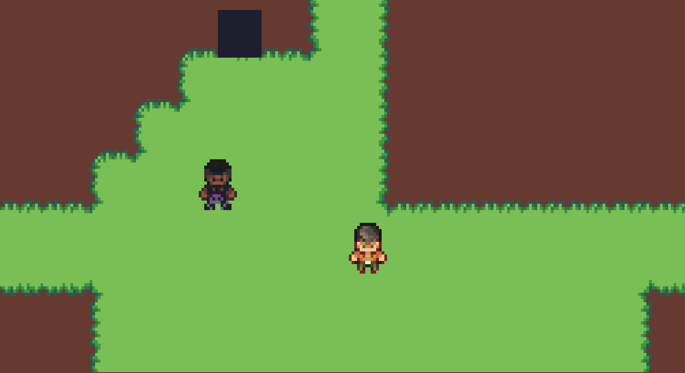
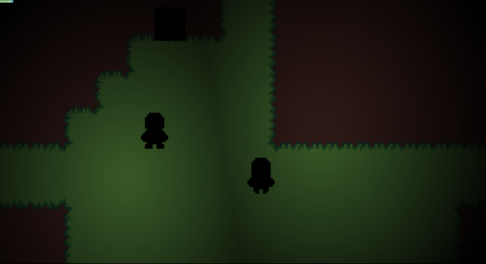

# Terminal-based game engine

## What is this?

This project is an attempt at creating a render and game engine in C++, working only with the std library as much as possible. It was made purely for academic purposes.

I tried to refrain from using anything but the standard library and the tools it allows, as well as not looking into similar projects, to challenge myself to come up with creative solutions to little documented issues.

## Features
### Rendering
The code can read the binary stream of .bmp-files, converting them into workable pixel data and storing that in memory. It prints images to the terminal using ANSI codes to customize position and color of a set string used as pixels (usually spaces), while keeping track of layers of pixels, to prevent the background-objects from being “eaten” when obstructed. This is done lazily, i.e., only pixels that actually change color are reprinted, to prevent slow-printing terminals from being a bottleneck. Moving few pixel-art characters around the level resulted in smooth frame rates on the Windows-Terminal.

The engine is also capable of cutting sprite-sheets into individual images given the correct dimensions and combining multiple sprites into animations which can be easily triggered.



Recently, I tried adding a prototypical 3D lighting engine, including point-lights, and reworking the geometry to add a z-axis. Pixels each store their height, which is calculated from the objects z-position plus a height-map on its sprite, thus enabling three-dimensional lighting on two-dimensional sprites. This is, so far, just a proof of concept and doesn't look too great.



As seen in the image, the characters are both pure black. That is due to their z-axis being calculated to be too far away from the lights compared to the floor.
An additional quirk of this rework is that images can “cut” into each other on a per-pixel basis, if their height-maps put one image only partly in front of another. 

### Scene-Hierarchy
The engine has a simple scene-hierarchy. A list of scenes, each holding objects which in turn can have children. These Objects have position data, and can get any components attached (like image renderers, animations, or custom written components by the engine's users). If the entire hierarchy scene → objects → components is marked as “active”, the component updates every tick.

### Collision (currently broken)
The collider-component enables collision using collision-maps to determine hitboxes, tested with simple combat, loading zones and walls. Calls to check collision are available to use in other components. (This feature is currently broken, after moving the project to a Linux environment and the subsequent rewrite, away from Windows and Visual Studio-only centered code)

### Input
This was one of my biggest struggles, and the one point where I had to break the “std-purity" of this project, since the std library (to my knowledge) does not provide a way to get live input. Instead, I used OS-specific code for Windows (not implemented anymore) and POSIX (current) related strategies to achieve this respectively. If I ever find a way to fix this, this project should, in theory, be truly cross-compatible across any system that can run C++ code.

## Build and run instructions
I haven't tried the current project on any other systems. I'm currently on Linux and running it in the kitty terminal, though I managed to display some (highly discolored) images in the Linux tty, so it should work on any Linux terminal in theory. It will not work on Windows in the current state. 

Requirements: 
- CMake >=3.30
- A compiler for C++26 (I'm using gcc 15.2.0. I haven't tested below that.)
- A POSIX terminal (Not tested outside of linux)

If you are on NixOS or using Nix to develop, a flake containing a dev environment and package is provided.

Just run this in your terminal to test it!
```sh
git clone https://github.com/MiiChii/TerminalGameEngine.git
cd TerminalGameEngine
cmake -S . -B build
cmake --build build
./build/untitled
```
**The screen will be black**, this is your time to size the terminal and font-size (See note below). Press enter to start the game.

**Please keep in mind:** If your terminal width cannot display the entire width of the game and adds line breaks instead, you will not see a coherent image. I recommend temporarily sizing your terminal font-size to 1 (easily done with ctrl+shift+- in kitty) and pulling it wider if that happens to you (for my smaller monitor, I have to have the terminal be wider than my screen. This could be true for you as well). 
